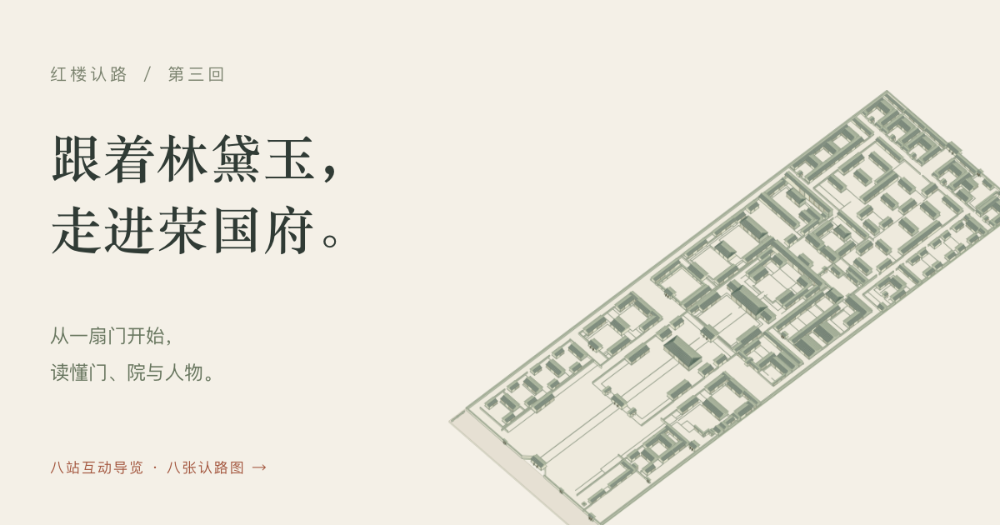

# 跟着林黛玉，走进荣国府 · 红楼认路

[开始八站导览](https://caiseyingzi.github.io/rongguofu/) · [自己逛一逛](https://caiseyingzi.github.io/rongguofu/#explore) · [下载八张图文](https://caiseyingzi.github.io/rongguofu/rongguofu-reading-cards.zip)

沿《红楼梦》第三回，从西角门、垂花门到贾母院，随黛玉认清门、院和人物。页面随阅读定位模型，每站都能展开查看对应原文，也可进入自由探索。配套八张 1080 × 1440 图文，包含总图与七个看点。

模型依据所附荣国府平面示意图描摹，保留原图纵横比例、院落位置和门道关系。可选择院落、点击房舍查看名称、拖动与缩放、揭开屋顶，并切换原图叠合核对。

## 使用

通过上方链接在线使用。网站通过 GitHub Pages 从 `main` 分支的根目录发布，无需安装运行时依赖。

本地预览时，在仓库目录运行 `python3 -m http.server 8000`，然后打开 `http://127.0.0.1:8000/`。请保留 `index.html`、`assets/`、`cards/` 与下载 ZIP 的相对位置。

- 点击模型中的房舍或门楼，显示名称和所属院落；标注跟随拖动与缩放，也支持手机触摸。
- 原图未单独命名的建筑会显示“原图未单独标名”。标注右上角或 Esc 键可关闭名称。
- 选择院落，拖动画布平移，滚轮或加减按钮缩放。
- “平面核对”中可调节原图显影透明度、显示或隐藏建模轮廓。
- 聚焦模型时，键盘左右键切换区域，Home 回全府，1/2 切换立体与平面，R 揭顶，F 适合画面。
- 手机可横向滑动院落名称，双指缩放模型；点中房舍后显示房名。
- 手机导览上方可直接选择章节、收起或展开地图。竖屏将地图固定在正文上方，窄横屏分为左右两栏，并适配安全区域。
- 导览中向下阅读或用模型上方箭头切站；“回到本段”可恢复当前段落的视角。
- 相邻站点以连续镜头、逐步延伸的路线与移动圆点连接。“垂花门 → 贾母院”依次经过穿堂、小厅，再到五间上房前；下方显示沿途节点，也可重走这一段。
- 拖动或缩放模型会暂停当前行进，保留圆点位置；系统设置减少动态效果时直接显示完整路线。动画在页面离屏或切到后台时暂停。
- 可以用 `#story-4` 直接分享第四站；`#explore` 直接打开自由探索。

## 阅读依据

故事依据[《红楼梦》第三回](https://zh.wikisource.org/zh-hans/%E7%B4%85%E6%A8%93%E5%A4%A2/%E7%AC%AC003%E5%9B%9E)“荣国府收养林黛玉”，各站附原文摘句。去贾赦处时，叙述先出西角门、经过荣府正门外，再入黑油大门；凤姐住处在回程中被指认，本段并未写入院拜访。

离开贾赦处时，原文写邢夫人送至仪门前，黛玉乘原车回到荣府，没有再写出黑油大门。回程不预设出街；中间具体通路原文省略，连线从回府后的穿堂接起。贾赦处送客的仪门与荣禧堂前的仪门分开说明，附图将后者标作“内仪门”，位于向南大厅之北、荣禧堂之南。第 4 站“贾赦院”集中说明回程，并提供仪门定位按钮。

导览按叙述次序选取节点，动态连线用来解释场景关系，转弯与院内折线为示意，不表示实测路线。原文与附图的对应属于辅助阅读的空间解释。

八张图文使用同一模型实际渲染，无外部配图；末张二维码指向本站。ZIP 同附可修改的发布文案。

## 模型说明

平面布局依据用户提供的 1005 × 2948 像素示意图。所有建筑使用同一套原图坐标，未分别拉伸横纵比例。

原图没有实测尺寸与立面，因此不换算米数；建筑高度、屋面坡度及柱窗细节为示意。这个模型用于辅助阅读和空间理解，不代表历史建筑原貌。

OBJ 与 MTL 需放在同一文件夹后导入三维软件。三维文件采用无量纲显示单位：1 单位对应原图 10 像素，X 向东、Y 向北、Z 向上。

## 更新网站

将更新后的 `index.html` 与对应的 `assets/` 文件一起推送到 `main`，GitHub Pages 会自动重新发布。静态发布文件不需要额外构建步骤；资源文件名包含内容摘要，以避免缓存混用。

## 性能处理

- 保留全部矢量模型。移动镜头期间使用浏览器合成层，在移动结束后重绘矢量，保留放大后的细节。
- 模型数据以 gzip 文件加载，首屏下载约 2 MB；原始平面图在首次进入“平面核对”时加载。
- 揭顶直接切换屋面可见性，避免逐帧重排大量屋面；选择样式仅作用于相关屋面。
- 加载失败时显示重试入口，离屏或切换到后台时暂停动画。
